

  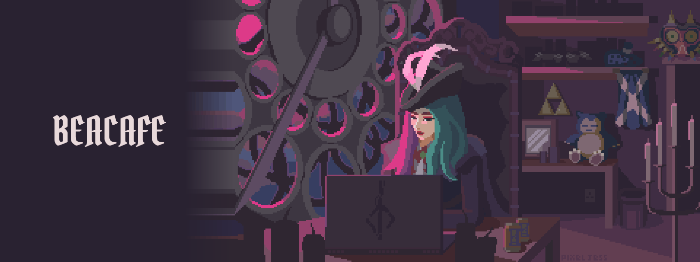

<h1 align="center">Bea</h1>

<b>Self-taught · exploring vibe coding</b>

<i>I want things to be beautiful.</i>

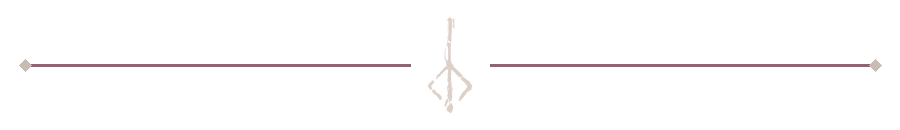

<h3 align="center">About me</h3>

<b>🇺🇸 English</b>

<h3 align="justify">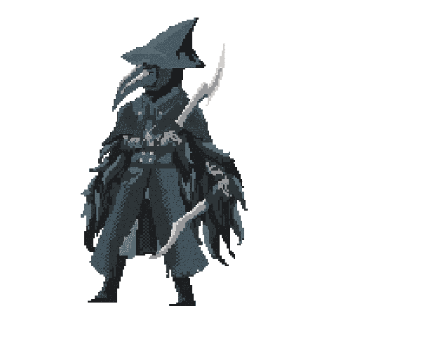<samp>Hi, I'm <b>Bea</b> — self-taught, curious, and learning through the things I build. I love <b>art and design</b>: colors, typography, interfaces, and the little details that give a project its own identity. I want the things I make to be <b>useful, intuitive, and beautiful</b>. Right now, I'm exploring <b>vibe coding</b> with AI assistance, experimenting, testing, and understanding more of the code along the way. My current focus is <b>an early 3D game prototype</b> where I'm exploring <b>JavaScript, Three.js, interfaces, lighting, and materials</b>. I enjoy shaping its visual direction and refining it through feedback. Still learning, still refining — one small improvement at a time.</samp></h3>

 

<b>🇧🇷 Português</b>

<h3 align="justify">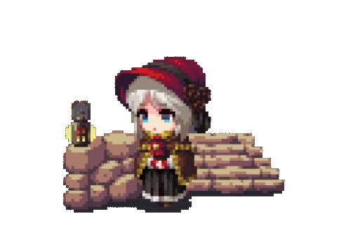<samp>Oi, eu sou a <b>Bea</b>! Sou autodidata, curiosa e amo <b>arte e design</b>: cores, tipografia, interfaces e os detalhes que dão identidade própria a cada projeto. Quero criar coisas <b>úteis, intuitivas e bonitas</b>. Estou explorando <b>vibe coding</b> com apoio de IA, aprendendo enquanto experimento, testo e entendo o código. Gosto de <b>jogos, servidores e ferramentas para Windows</b> e sempre acabo me envolvendo com o lado visual do que construo. Meu foco atual é <b>um protótipo de jogo 3D em estágio inicial</b>, no qual estou explorando <b>JavaScript, Three.js, interfaces, iluminação e materiais</b>, além de dar direção visual ao projeto. Sigo aprendendo e refinando, um detalhe de cada vez.</samp></h3>

 

<h3 align="center">On my workbench</h3>

Technologies I'm exploring through my projects

  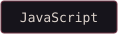
  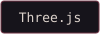
  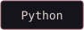
  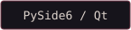
  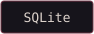
  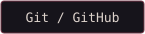

<h3 align="left">A little world of my own</h3>

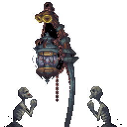

<h3>3D game prototype · work in progress</h3>

<h3 align="justify"><samp>An early <b>3D game project</b> combining my love of art, atmosphere, and software. The current prototype is a <b>Three.js environment</b> with a procedural house and vegetation, PBR materials, lighting, fog, and camera controls. With AI assistance, I am learning how these pieces fit together, testing visual changes, and refining the interface. It is still an environment prototype, with gameplay and simulation ahead — a place to learn by building.</samp></h3>

<a href="https://github.com/beacafe/sky-cozy-launcher"><b>Earlier project: Sky Cozy launcher ↗</b></a>

 

<h3 align="center">Let's connect</h3>

Find me on LinkedIn to follow what I'm learning and building.

  

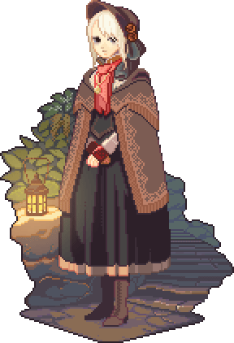

